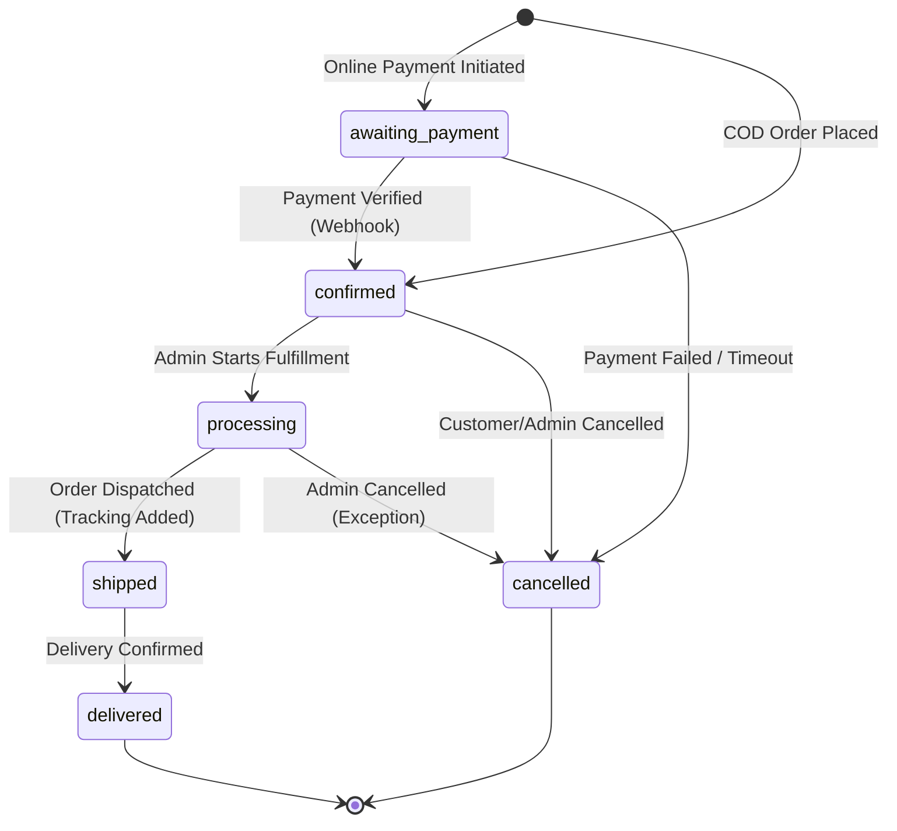
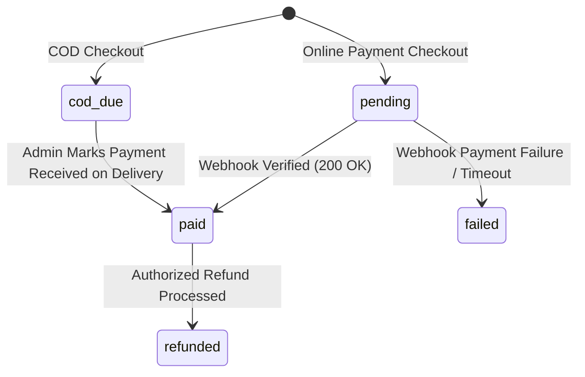

# Architecture & Design Document (Phase 0)

## 1. Executive Summary & V1 Scope

**Project Name:** DripRack Backend API (V1)  
**System Type:** Modular Monolith RESTful API  
**Target Client:** Standalone React Frontend (Single-Store E-Commerce)  
**Protocol Prefix:** `/api/v1`  
**Data Storage:** MongoDB Atlas (Mongoose ODM) with Transaction Support  

### Core Scope:
1. **Customer Capabilities:**
   - Account registration with role enforcement (`customer` only).
   - Secure login, logout, refresh session rotation, current profile query, and password reset via token.
   - Public product and category exploration (pagination, filtering by category and stock status, search, strict sort allowlisting).
   - Server-authoritative cart management (rejecting negative/invalid quantities, calculating totals dynamically).
   - Customer-owned delivery address management with primary address selection.
   - Checkout quote calculation and idempotent order placement.
   - Cash on Delivery (COD) payment flow with provider-agnostic online gateway architecture for future activation.
   - Customer order history tracking and self-service cancellation of eligible orders.

2. **Administrator Capabilities:**
   - Initialized via a protected, idempotent CLI bootstrap script (`scripts/createAdmin.js`).
   - Catalog management: Create, update, publish/unpublish, and archive products and categories.
   - Inventory control: Real-time physical vs. reserved vs. available stock calculation, atomic adjustments with mandatory reason logging and immutable audit trail.
   - Order fulfillment: State transition management (`confirmed` -> `processing` -> `shipped` -> `delivered`), tracking detail recording, cancellation handling, and restocking.
   - Operational dashboard: Bounded summary analytics (total revenue, order counts by status, low-stock warnings, recent order feed).

---

## 2. Use-Case List by Role

### Guest / Public User
- `UC-G01`: View published product listing with pagination and search.
- `UC-G02`: View published product details by slug or ID.
- `UC-G03`: View active categories.
- `UC-G04`: Register new customer account (always assigned `customer` role).
- `UC-G05`: Authenticate (login) and receive short-lived access token + HttpOnly refresh token cookie.
- `UC-G06`: Request password reset token via email.
- `UC-G07`: Reset password using single-use valid reset token.
- `UC-G08`: Perform health check (`/health/live`, `/health/ready`).

### Customer
- `UC-C01`: Rotate refresh token to receive a fresh access token.
- `UC-C02`: Terminate session (logout) revoking refresh session.
- `UC-C03`: Fetch authenticated user profile (`/api/v1/auth/me`).
- `UC-C04`: Manage shopping cart (read, add item, update quantity, remove item, clear).
- `UC-C05`: Manage shipping addresses (create, list, update, delete, set default).
- `UC-C06`: Request checkout quote (server-side recalculated pricing, tax, shipping).
- `UC-C07`: Place order idempotently using `Idempotency-Key` header.
- `UC-C08`: View own order history and order details.
- `UC-C09`: Cancel own order if in an eligible status (`awaiting_payment`, `confirmed`).

### Administrator
- `UC-A01`: Secure login with admin credentials.
- `UC-A02`: Create, edit, publish/unpublish, and archive categories.
- `UC-A03`: Create, edit, publish/unpublish, and archive products.
- `UC-A04`: Inspect inventory levels (physical, reserved, available).
- `UC-A05`: Perform manual inventory adjustments (specifying quantity change and mandatory audit reason).
- `UC-A06`: View inventory movement history logs.
- `UC-A07`: View all store orders with multi-status filters and pagination.
- `UC-A08`: Update order fulfillment status with tracking data.
- `UC-A09`: Cancel order and execute automated inventory restock.
- `UC-A10`: View admin dashboard metrics (sales totals, status breakdown, low stock alert).

---

## 3. High-Level Modular Monolith Architecture

The system is organized into decoupled feature modules under `src/modules/` with centralized cross-cutting concerns under `src/middleware/`, `src/utils/`, and `src/config/`.

```
                    +------------------------------------+
                    |        Client (React SPA)          |
                    +-----------------+------------------+
                                      |
                      HTTPS / REST (/api/v1)
                                      |
                    +-----------------v------------------+
                    |    Security & Infrastructure Layer |
                    | - Helmet (HTTP Headers)            |
                    | - CORS Allowlist                   |
                    | - Request ID Middleware            |
                    | - Rate Limiters (Global & Strict)  |
                    | - Body Parser (JSON limit 100kb)   |
                    | - Cookie Parser (HttpOnly refresh) |
                    | - Pino Structured HTTP Logger      |
                    +-----------------+------------------+
                                      |
                    +-----------------v------------------+
                    |           Router Engine            |
                    |           /api/v1 routes           |
                    +-----------------+------------------+
                                      |
      +-------------------------------+-------------------------------+
      |                               |                               |
+-----v---------------+     +---------v---------+           +---------v---------+
|    Auth & Users     |     | Catalog & Stock   |           | Orders & Checkout |
| - Registration      |     | - Products        |           | - Cart Engine     |
| - Sessions (JWT)    |     | - Categories      |           | - Address Book    |
| - Password (Argon2) |     | - Inventory Move  |           | - Quote Engine    |
| - RBAC Guard        |     | - Atomic Stock    |           | - Order Lifecycle |
+---------------------+     +-------------------+           +-------------------+
                                      |                               |
                                      +---------------+---------------+
                                                      |
                                            +---------v---------+
                                            | Payment Service   |
                                            | - COD Strategy    |
                                            | - Gateway Adapter |
                                            +---------+---------+
                                                      |
                                            +---------v---------+
                                            | Mongoose ODM /    |
                                            | MongoDB ReplicaSet|
                                            | (ACID Transaction)|
                                            +-------------------+
```

---

## 4. State Transition Machines

### 4.1 Order Lifecycle State Machine

Valid order states:
- `awaiting_payment`
- `confirmed`
- `processing`
- `shipped`
- `delivered`
- `cancelled`



#### Order State Transition Rules:
1. **Creation:** COD orders directly enter `confirmed`. Online payments enter `awaiting_payment`.
2. **Cancellation:** Orders in `awaiting_payment` or `confirmed` can be cancelled by the customer. Orders in `processing` can only be cancelled by an administrator. Orders in `shipped` or `delivered` cannot be cancelled (must follow return/refund policy in future versions).
3. **Restocking Guarantee:** Transitioning to `cancelled` triggers an idempotent stock release or restock movement. A database flag `isStockRestocked: true` guarantees restocking happens exactly once.

### 4.2 Payment State Machine

Valid payment states:
- `pending`: Payment transaction initialized.
- `paid`: Payment captured and verified via webhook signature.
- `failed`: Payment declined or expired.
- `cod_due`: Cash on delivery due upon receipt.
- `refunded`: Authoritative refund confirmed.



---

---

## 5. Stock Consistency, Concurrency & Inventory Architecture (Phase 4)

E-commerce inventory requires zero overselling under race conditions, integer-only stock counts, and append-only audit tracking.

### 5.1 Stock Invariant
The Product model remains the single source of truth for real-time stock levels:
$$\text{Available Stock} = \text{Physical Quantity} - \text{Reserved Quantity}$$

### Required System Invariants:
1. All stock quantities are non-negative integers ($\text{physical} \ge 0, \text{reserved} \ge 0, \text{available} \ge 0$).
2. Reserved stock cannot exceed physical stock ($\text{reserved} \le \text{physical}$).
3. Available stock must strictly equal physical minus reserved ($\text{available} = \text{physical} - \text{reserved}$).
4. New products start with zero stock (`{ physical: 0, reserved: 0, available: 0 }`).
5. The Inventory Service is the **only** application service authorized to mutate stock. General catalog create/update/status endpoints reject or strip all stock modifications.

### 5.2 Atomic Stock Adjustments & Transaction Safety
Every stock adjustment executes inside a MongoDB multi-document ACID transaction:
```javascript
// Negative stock adjustment atomically enforcing available stock condition
const updatedProduct = await Product.findOneAndUpdate(
  {
    _id: productId,
    "stock.available": { $gte: Math.abs(quantityDelta) } // Enforces non-negativity and reservation buffer atomically
  },
  { 
    $inc: { 
      "stock.physical": quantityDelta,
      "stock.available": quantityDelta
    } 
  },
  { session, new: true }
);

if (!updatedProduct) {
  throw ApiError.conflict('Stock update conflict or insufficient available stock', 'STOCK_UPDATE_CONFLICT');
}

// Append-only audit record created in the same transaction
await InventoryMovement.create(
  [
    {
      product: updatedProduct._id,
      sku: product.sku, // Immutable SKU snapshot
      movementType: 'adjustment',
      quantityDelta,
      previousPhysical: product.stock.physical,
      newPhysical: updatedProduct.stock.physical,
      previousAvailable: product.stock.available,
      newAvailable: updatedProduct.stock.available,
      actor: actorId,
      actorRole: 'admin',
      reason: reason.trim(),
      idempotencyKey: idempotencyKey || null,
      idempotencyPayloadHash: idempotencyKey ? payloadHash : null
    }
  ],
  { session }
);
```

### 5.3 Idempotency Strategy
- **Header:** `Idempotency-Key` (up to 128 chars).
- **Index:** Enforced at database level via `{ idempotencyKey: 1 }` with `partialFilterExpression: { idempotencyKey: { $type: "string" } }` on `inventory_movements`.
- **Payload Hash:** SHA-256 hash of `{ productId, quantityDelta, reason }`.
- **Replay Behavior:**
  - Matching key + matching hash: Safely returns existing movement and current product (200 OK) without double adjustment.
  - Matching key + mismatched hash: Rejected immediately with `409 Conflict` (`IDEMPOTENCY_CONFLICT`).
  - Concurrent requests with identical key: Database unique constraint halts duplicate execution, and the service transparently resolves the replay.

### 5.4 Audit Trail Immutability
`InventoryMovement` documents are strictly append-only. No edit, update, or delete routes are exposed anywhere in the API. Snapshot SKUs preserve historical fidelity even if an administrator renames a product SKU in future catalog updates.

---

## 6. Unresolved Decisions & Safe Defaults

| Decision Area | Unresolved Aspect | Chosen Safe Default for V1 |
| :--- | :--- | :--- |
| **Payment Provider** | Production merchant keys unavailable initially | **Cash on Delivery (COD)** implemented end-to-end. Provider-neutral `IPaymentGateway` interface implemented with a Stripe-ready adapter in disabled mock/sandbox mode until credentials are provided. |
| **Tax Calculation** | Dynamic regional jurisdictions (e.g., US states, EU VAT) | Explicit, server-side configurable tax policy via `TAX_RATE_PERCENT` (default: 0% or configured integer percentage). Minor currency calculations only. |
| **Shipping Fees** | Carrier API integration (FedEx/UPS/DHL) | Server-side tiered rule: Configurable flat fee `SHIPPING_FLAT_FEE_CENTS` (e.g. 500 = $5.00), free above `FREE_SHIPPING_THRESHOLD_CENTS` (e.g. 5000 = $50.00). |
| **Currency** | Multi-currency exchange rates | Single store currency in minor integer units (e.g. `USD` in cents: $19.99 = `1999`). Zero floating-point rounding errors. |
| **Product Variants** | Multi-dimensional matrix (e.g., Color x Size) | First-class distinct SKUs: each purchasable item has a distinct SKU and independent stock tracking. Parent products group variants. |
| **Email Delivery** | Third-party SMTP / SendGrid / Resend credentials | Modular `EmailService`: In `development`/`test`, outputs formatted log with reset token and action URL. In `production`, requires validated SMTP/API credentials. |
| **Image Storage** | S3 / Cloudinary credentials | Image URLs validated against safe HTTPS patterns. Local/trusted mock asset provider in development, decoupled storage interface ready for S3. |
| **Idempotency** | Duplicate order retries | Client sends `Idempotency-Key` header (UUIDv4) stored on Order collection with unique index constraint. Repeated requests return original order safely. |
