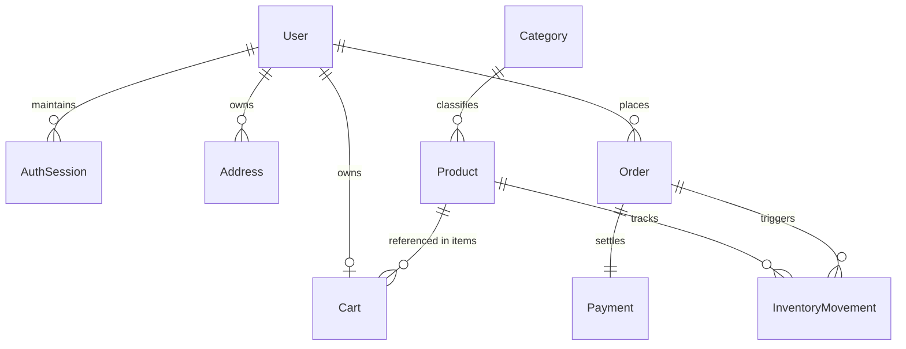

# Database Schema & Data Integrity Design (Phase 0)

## 1. Overview & Data Integrity Principles

The DripRack database is designed on MongoDB with Mongoose ODM, adhering to these core principles:
1. **Integer Minor Units:** All monetary values (prices, subtotal, tax, shipping, grand total) are stored as integers (e.g. `$49.99` is stored as `4999`).
2. **Immutable Snapshots:** Orders and order items preserve immutable snapshots of customer addresses, product titles, SKUs, and unit prices at the instant of checkout. Later catalog or address changes never alter historical orders.
3. **Database-Enforced Uniqueness:** Uniqueness is not assumed from application code; compound and single-field unique indexes are explicitly created in MongoDB.
4. **Normalized Storage with Strategic Denormalization:** Categories and inventory history are normalized; cart and address lists are modeled cleanly with reference and embedded sub-documents where appropriate.
5. **ACID Transactions:** Stock deductions, order creation, cart clearance, and movement logging execute within a multi-document MongoDB transaction.

---

## 2. Collection Schemas & Entity Relationships



---

### 2.1 User Collection (`users`)

| Field | Type | Required | Default | Constraints & Description |
| :--- | :--- | :--- | :--- | :--- |
| `_id` | ObjectId | Yes | Auto | Primary Key |
| `email` | String | Yes | - | Lowercase, trimmed, unique index, validated email format |
| `passwordHash` | String | Yes | - | Argon2id hash string. Never exposed in API responses (`select: false`) |
| `firstName` | String | Yes | - | Max 50 chars, trimmed |
| `lastName` | String | Yes | - | Max 50 chars, trimmed |
| `role` | String | Yes | `customer` | Enum: `['customer', 'admin']`. Public registration forces `customer` |
| `status` | String | Yes | `active` | Enum: `['active', 'suspended', 'deactivated']` |
| `passwordResetToken` | String | No | null | SHA-256 hash of single-use reset token (`select: false`) |
| `passwordResetExpiresAt` | Date | No | null | Expiry timestamp (typically 1 hour) |
| `failedLoginAttempts` | Number | Yes | 0 | For progressive backoff and temporary lockouts |
| `lockUntil` | Date | No | null | Temporary lock timestamp on excessive failed logins |
| `createdAt` | Date | Yes | Auto | Timestamp |
| `updatedAt` | Date | Yes | Auto | Timestamp |

**Indexes:**
- `{ email: 1 }` (Unique, Collation: `{ locale: 'en', strength: 2 }`)
- `{ status: 1 }`

---

### 2.2 AuthSession Collection (`auth_sessions`)

Stores cryptographic refresh token verifiers to support rotating, revocable refresh tokens without storing plaintext secrets.

| Field | Type | Required | Constraints & Description |
| :--- | :--- | :--- | :--- |
| `_id` | ObjectId | Yes | Auto Primary Key |
| `user` | ObjectId | Yes | Ref to `User`, indexed |
| `tokenHash` | String | Yes | SHA-256 hash of refresh token string (unique) |
| `deviceInfo` | String | No | User-agent string snippet |
| `ipAddress` | String | No | Client IP address at session creation |
| `isRevoked` | Boolean | Yes | Default: `false` |
| `expiresAt` | Date | Yes | TTL Index for automatic MongoDB expiration |
| `createdAt` | Date | Yes | Timestamp |
| `updatedAt` | Date | Yes | Timestamp |

**Indexes:**
- `{ tokenHash: 1 }` (Unique)
- `{ user: 1, isRevoked: 1 }`
- `{ expiresAt: 1 }` (TTL: `expireAfterSeconds: 0`)

---

### 2.3 Category Collection (`categories`)

| Field | Type | Required | Constraints & Description |
| :--- | :--- | :--- | :--- |
| `_id` | ObjectId | Yes | Auto Primary Key |
| `name` | String | Yes | Unique name, max 60 chars |
| `slug` | String | Yes | Unique URL slug (kebab-case) |
| `description` | String | No | Max 500 chars |
| `isActive` | Boolean | Yes | Default: `true` |
| `createdAt` | Date | Yes | Timestamp |
| `updatedAt` | Date | Yes | Timestamp |

**Indexes:**
- `{ slug: 1 }` (Unique)
- `{ name: 1 }` (Unique)
- `{ isActive: 1 }`

---

### 2.4 Product Collection (`products`)

| Field | Type | Required | Constraints & Description |
| :--- | :--- | :--- | :--- |
| `_id` | ObjectId | Yes | Auto Primary Key |
| `sku` | String | Yes | Unique SKU code (uppercase, alphanumeric + hyphens) |
| `slug` | String | Yes | Unique URL-friendly slug |
| `name` | String | Yes | Product title (max 200 chars) |
| `description` | String | Yes | Markdown / sanitized text description |
| `category` | ObjectId | Yes | Ref to `Category`, indexed |
| `priceCents` | Number | Yes | Integer minor units (e.g. $25.00 -> `2500`), min: 0 |
| `compareAtPriceCents` | Number | No | Optional list/strikethrough price in cents, min: 0 |
| `images` | Array[String]| Yes | Array of validated image URLs |
| `status` | String | Yes | Enum: `['draft', 'published', 'archived']`, default: `'draft'` |
| `stock.physical` | Number | Yes | Physical inventory on hand, integer >= 0, default: 0 |
| `stock.reserved` | Number | Yes | Reserved for pending orders, integer >= 0, default: 0 |
| `stock.available` | Number | Yes | Available for sale: (physical - reserved), integer >= 0 |
| `lowStockThreshold` | Number | Yes | Default: 5. Flags stock warnings for admin |
| `createdAt` | Date | Yes | Timestamp |
| `updatedAt` | Date | Yes | Timestamp |

**Indexes:**
- `{ sku: 1 }` (Unique)
- `{ slug: 1 }` (Unique)
- `{ status: 1, category: 1, "stock.available": 1 }` (Compound index for public catalog queries)
- `{ name: "text", description: "text" }` (Text index for keyword search)
- `{ "stock.available": 1 }` (For low stock queries)

---

### 2.5 InventoryMovement Collection (`inventory_movements`)

Provides an append-only, tamper-evident audit trail for every single stock change in the system.

| Field | Type | Required | Constraints & Description |
| :--- | :--- | :--- | :--- |
| `_id` | ObjectId | Yes | Auto Primary Key |
| `product` | ObjectId | Yes | Ref to `Product`, indexed |
| `sku` | String | Yes | Product SKU snapshot at adjustment time |
| `movementType` | String | Yes | Enum: `['adjustment', 'reservation', 'release', 'sale', 'restock']` |
| `quantityDelta` | Number | Yes | Signed integer (positive or negative change) |
| `previousPhysical` | Number | Yes | Physical quantity before mutation (Integer, $\ge 0$) |
| `newPhysical` | Number | Yes | Physical quantity after mutation (Integer, $\ge 0$) |
| `previousAvailable`| Number | Yes | Available quantity before mutation (Integer, $\ge 0$) |
| `newAvailable` | Number | Yes | Available quantity after mutation (Integer, $\ge 0$) |
| `actor` | ObjectId | Yes | Ref to `User` performing the action |
| `actorRole` | String | Yes | Enum: `['admin', 'customer', 'system']` |
| `orderReference` | String | No | Linked order reference if movement is order-related |
| `reason` | String | Yes | Mandatory explanation (Min 3, max 500 chars) |
| `idempotencyKey` | String | No | Optional key passed by client in header for adjustment deduplication |
| `idempotencyPayloadHash` | String | No | SHA-256 hash of `{ productId, quantityDelta, reason }` |
| `createdAt` | Date | Yes | Timestamp |
| `updatedAt` | Date | Yes | Timestamp |

**Indexes:**
- `{ product: 1, createdAt: -1 }` (Product movement history)
- `{ movementType: 1, createdAt: -1 }` (Movement type filtering)
- `{ actor: 1, createdAt: -1 }` (Auditing administrator actions)
- `{ orderReference: 1 }` (Sparse, for order-linked movements)
- `{ idempotencyKey: 1 }` (Unique with `partialFilterExpression: { idempotencyKey: { $type: "string" } }` for deduplication)

---

### 2.6 Cart Collection (`carts`)

Customer-owned shopping cart. Prices are **not** stored authoritatively; only item references and requested quantities.

| Field | Type | Required | Constraints & Description |
| :--- | :--- | :--- | :--- |
| `_id` | ObjectId | Yes | Auto Primary Key |
| `user` | ObjectId | Yes | Ref to `User`, unique (one cart per customer) |
| `items` | Array | Yes | Sub-documents: `[{ _id: ObjectId, product: ObjectId, quantity: Number, addedAt: Date }]` |
| `createdAt` | Date | Yes | Timestamp |
| `updatedAt` | Date | Yes | Timestamp |

**Constraints:**
- Item `quantity` must be positive integer ($1 \le q \le 99$).
- Sub-document validator and atomic `$ne` update queries ensure no duplicate product entries in the same cart.
- Non-authoritative: Checkout (Phase 6) recalculates all amounts independently. Zero inventory mutations occur on cart operations.

**Indexes:**
- `{ user: 1 }` (Unique)

---

### 2.7 Address Collection (`addresses`)

Customer-owned delivery address book.

| Field | Type | Required | Constraints & Description |
| :--- | :--- | :--- | :--- |
| `_id` | ObjectId | Yes | Auto Primary Key |
| `user` | ObjectId | Yes | Ref to `User`, indexed |
| `recipientName` | String | Yes | Max 100 chars, trimmed |
| `phone` | String | Yes | E.164 or national phone format (7-25 chars) |
| `streetAddress1`| String | Yes | Max 150 chars, trimmed |
| `streetAddress2`| String | No | Max 150 chars, default: `''` |
| `city` | String | Yes | Max 100 chars, trimmed |
| `state` | String | Yes | Max 100 chars, trimmed |
| `postalCode` | String | Yes | Postal/Zip code string (2-20 chars, preserves leading zeros) |
| `country` | String | Yes | ISO 2-letter uppercase country code (e.g. `'US'`, `'IN'`) |
| `isDefault` | Boolean | Yes | Default: `false` (First created address is automatically `true`) |
| `createdAt` | Date | Yes | Timestamp |
| `updatedAt` | Date | Yes | Timestamp |

**Indexes:**
- `{ user: 1, isDefault: -1, createdAt: -1 }` (Deterministic user listing: default address first, then newest)
- `{ user: 1 }` (`unique: true, partialFilterExpression: { isDefault: true }`) (Enforces database-level constraint: at most one default address per customer)

---

### 2.8 Order Collection (`orders`)

The primary transaction entity. Contains immutable snapshots of products, pricing, and destination address.

| Field | Type | Required | Constraints & Description |
| :--- | :--- | :--- | :--- |
| `_id` | ObjectId | Yes | Auto Primary Key |
| `orderReference` | String | Yes | Non-guessable public reference, e.g. `ORD-20261027-A9F3K` (Unique) |
| `idempotencyKey` | String | No | UUIDv4 passed during checkout to prevent duplicate orders (Sparse Unique) |
| `customer` | ObjectId | Yes | Ref to `User`, indexed |
| `items` | Array | Yes | Immutable array of line items (schema detailed below) |
| `currency` | String | Yes | ISO 4217 currency code (e.g. `'USD'`) |
| `subtotalCents` | Number | Yes | Integer minor units |
| `shippingCents` | Number | Yes | Integer minor units |
| `taxCents` | Number | Yes | Integer minor units |
| `totalCents` | Number | Yes | `subtotalCents + shippingCents + taxCents` |
| `shippingAddress`| Object | Yes | Immutable copy of delivery address fields |
| `orderStatus` | String | Yes | Enum: `['awaiting_payment', 'confirmed', 'processing', 'shipped', 'delivered', 'cancelled']` |
| `paymentMethod` | String | Yes | Enum: `['cod', 'online']` |
| `paymentStatus` | String | Yes | Enum: `['pending', 'paid', 'failed', 'refunded', 'cod_due']` |
| `isStockRestocked`| Boolean| Yes | Default: `false`. Guarantees restocking runs at most once on cancellation |
| `tracking` | Object | No | `{ carrier: String, trackingNumber: String, trackingUrl: String, dispatchedAt: Date }` |
| `cancellation` | Object | No | `{ cancelledAt: Date, cancelledBy: ObjectId, reason: String }` |
| `createdAt` | Date | Yes | Timestamp |
| `updatedAt` | Date | Yes | Timestamp |

#### Item Snapshot Sub-schema:
```javascript
{
  product: ObjectId,          // Reference
  sku: String,                // Snapshot
  name: String,               // Snapshot
  unitPriceCents: Number,     // Snapshot
  quantity: Number,           // Snapshot
  lineTotalCents: Number      // unitPriceCents * quantity
}
```

**Indexes:**
- `{ orderReference: 1 }` (Unique)
- `{ idempotencyKey: 1 }` (Unique, Sparse)
- `{ customer: 1, createdAt: -1 }` (Customer history pagination)
- `{ orderStatus: 1, createdAt: -1 }` (Admin status queries)

---

### 2.9 Payment Collection (`payments`)

Stores payment records, gateway transactions, and webhook event logs.

| Field | Type | Required | Constraints & Description |
| :--- | :--- | :--- | :--- |
| `_id` | ObjectId | Yes | Auto Primary Key |
| `order` | ObjectId | Yes | Ref to `Order`, indexed |
| `orderReference` | String | Yes | Link to order reference |
| `provider` | String | Yes | Enum: `['cod', 'stripe', 'mock']` |
| `providerPaymentId`| String | No | External gateway transaction/intent ID (indexed) |
| `amountCents` | Number | Yes | Minor units |
| `currency` | String | Yes | Currency code (e.g. `'USD'`) |
| `status` | String | Yes | Enum: `['pending', 'paid', 'failed', 'refunded', 'cod_due']` |
| `processedEvents` | Array[String]| Yes | List of external event IDs to ensure idempotent webhook handling |
| `failureReason` | String | No | Sanitized failure message from gateway |
| `createdAt` | Date | Yes | Timestamp |
| `updatedAt` | Date | Yes | Timestamp |

**Indexes:**
- `{ order: 1 }`
- `{ orderReference: 1 }`
- `{ providerPaymentId: 1 }` (Sparse)
- `{ "processedEvents": 1 }`

---

### 2.10 AuditLog Collection (`audit_logs`)

Maintains security and governance logs for critical administrator actions.

| Field | Type | Required | Constraints & Description |
| :--- | :--- | :--- | :--- |
| `_id` | ObjectId | Yes | Auto Primary Key |
| `actor` | ObjectId | Yes | Ref to `User` |
| `action` | String | Yes | E.g. `PRODUCT_ARCHIVED`, `STOCK_ADJUSTED`, `ORDER_STATUS_CHANGED` |
| `resourceType` | String | Yes | E.g. `product`, `order`, `inventory` |
| `resourceId` | String | Yes | Target resource identifier |
| `ipAddress` | String | No | Client IP |
| `details` | Object | No | Key metadata changes (sanitized) |
| `createdAt` | Date | Yes | Timestamp |

**Indexes:**
- `{ actor: 1, createdAt: -1 }`
- `{ resourceType: 1, resourceId: 1 }`
